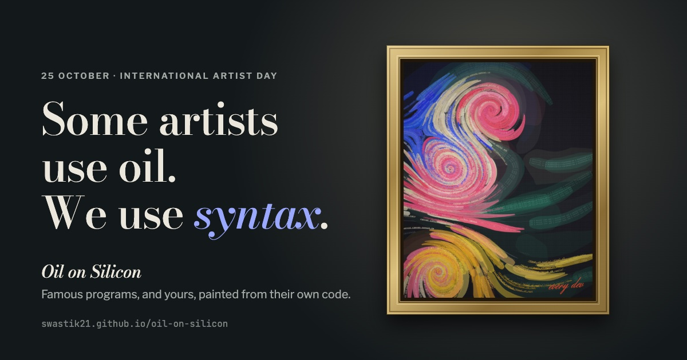

# Oil on Silicon

An exhibition for International Artist Day, 25 October. Six well-known programs hang as paintings, from Euclid's algorithm (c. 300 BCE) to the fast inverse square root in Quake III Arena (1999), and each one is painted by its own source code. Hover over a painting and the brush marks turn out to be the code.

https://swastik21.github.io/oil-on-silicon/

The studio at the bottom of the page paints whatever code you paste into it. Same code, same painting, every time.

## Running it locally

There's no build step, but the scripts are ES modules, so the folder has to be served rather than opened as a file:

    python3 -m http.server

and then open http://localhost:8000.

## How it works

`js/syntax.js` splits the code into tokens, and `js/painter.js` turns each token into brush strokes that follow a flow field. Brackets become the pencil underdrawing, comments become thin glazes, numbers become dabs, and the rest is painted in its syntax colour. Each stroke has its token's letters written along it, which is what the magnifier picks up.
